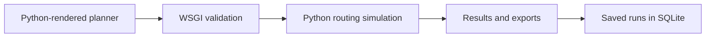

# ErrandLab

**Plan errands around uncertain travel, closing times and a deadline to get home.**

ErrandLab helps people who combine several stops into one outing. Enter two to six errands, opening hours, visit durations, approximate distances and a return deadline. The app compares four strategies, shows their timelines, and estimates how often each route completes every stop and gets home on time.

## Try ErrandLab online

Open the [hosted ErrandLab app](https://errand-lab.streamlit.app/) to plan a route, explore the evidence, or chat with Capi. You can use it directly in your browser.

### Deploy on Streamlit Community Cloud

Create the hosted app from this repository and set **Main file path** to `streamlit_app.py`. Use Python 3.12 or 3.13 if configuring a version. The hosted demo includes the route planner, comparison downloads, evidence, the Overview route film and Capi chat. The local WSGI app includes the account workspace and interactive 3D.

To enable Groq in the hosted app, add this to **App settings → Secrets**:

```toml
GROQ_API_KEY = "your-groq-key"
```

The server uses that key to classify questions. Visitors can use Capi directly. Without a key, hosted Capi still offers built-in ErrandLab guidance.

### Optional local setup

```bash
git clone https://github.com/adrian-hue-pixel/errand-lab.git
cd errand-lab
```

You can also download the repository ZIP and open a terminal in the extracted folder.

Requires Python 3.10 or newer. Routing runs locally using the Python standard library. Capi chat is optional.

```bash
python3 app.py
```

Open [ErrandLab on port 8501](http://127.0.0.1:8501). On Windows, use `py -3 app.py` if `python3` is unavailable. If the port is busy, run `python3 app.py --port 8502` and open port 8502.

1. Sign in with your email and password, create an account, or use **Demo quick sign-in** for an isolated temporary workspace. Existing username accounts can still sign in.
2. Open **Plan a route**, choose Closing time, and compare strategies. Save completed runs to your account.
3. Open **Settings** to select the theme, ambient motion, notification preferences and mascot visibility. For Capi chat, get a key from the [Groq Console](https://console.groq.com/keys), enter it under **Groq API key**, and select **Save and test key**. Your key is stored in the browser session for that tab. Demo sign-in, route comparisons, exports and Cinema require no key.
4. Open **Profile** to change your display name, avatar, role or bio. Signing out ends the server session. Demo workspaces are disposable.
5. **Sample route** supports a Three.js viewport and synchronized cinema player. West 112th Street features four supplied assets and a 12-second curbside arrival film. See [model integration](models/README.md) and [cinema integration](media/README.md).

The route grid uses approximate east/west and north/south offsets from home. For a shop 800 metres west and 300 metres north, use −0.8 and 0.3. Stops can have the same location. The app estimates travel time from the offsets and opening windows. Street directions and live traffic are outside this model.

## Research question

When errand closing times are tight, does delay-aware routing improve the chance of completing every stop and getting home on time compared with nearest-stop routing and an optimizer that assumes fixed travel times?

The primary outcome is **full success**, defined as completing every visit within its opening window and returning by the deadline. Secondary outcomes include mean completed stops, on-time return, median outing time, 90th-percentile outing time, and mean driving time.

## Benchmark results

### 300 randomly generated outings

At the default settings, delay-aware routing **beat nearest stop in 92 of 300 cases (30.7%)** and improved the average full-success rate by **13.33 percentage points**. Against the fixed-time optimizer it won 40 cases and lost 24, but averaged **0.25 points lower** because the losses had a larger net effect.

| Comparator | Wins | Ties | Losses | Average lift |
| --- | ---: | ---: | ---: | ---: |
| Nearest stop | 92 | 182 | 26 | +13.33 pp |
| Fixed-time optimizer | 40 | 236 | 24 | −0.25 pp |
| Entered order | 108 | 179 | 13 | +18.86 pp |
| Best of all three baselines in each case | 25 | 231 | 44 | −1.54 pp |

The generator uses seed 20471 and keeps all 300 cases, including easy and infeasible ones. Cases have two to five stops with random distances, opening windows, priorities, visit durations, deadlines and traffic categories. Delay-aware routing selects an order using 48 training draws. All policies are evaluated on the same 600 independent held-out draws per case. A win means one or more extra full successes on those 600 draws. The CSV also counts differences of at least five percentage points, such as **74 gains versus 11 losses** against nearest stop at the default settings.

### Sensitivity to traffic spread and downside weight

Cells show **average full-success lift versus the fixed-time optimizer** in percentage points. The spread multiplier scales both the day-wide and per-leg traffic variation in training and evaluation. A weight of zero still accounts for traffic variation through the mean utility.

| Traffic spread | Weight 0.00 | Weight 0.35 | Weight 0.70 |
| --- | ---: | ---: | ---: |
| 0.5× | +1.35 | +0.80 | −0.19 |
| 1.0× | +1.95 | −0.25 | −1.56 |
| 1.5× | +2.83 | −0.71 | −2.35 |

Weight 0.00 had the highest average full-success lift in this sweep. The app retains 0.35. Selecting a new default based on these results would warrant a fresh set of cases. These synthetic results depend on the generator and traffic model. They provide no estimate of performance on real road networks.

[Per-case results](evidence/random_cases.csv) · [All sensitivity comparisons](evidence/sensitivity.csv) · [Reproduction script](benchmark_random.py)

### Timing check on 20 real errand outings

Federal Highway Administration’s [2022 National Household Travel Survey](https://nhts.ornl.gov/downloads), public-use CSV v2.1, records travel diaries. We selected 20 outings using seed 8051 from 294 eligible households. Each outing was consecutively reported by one driver, started and ended at home on the same day, and had 2–6 shopping or personal errand stops. We included one qualifying outing per household and excluded missing or invalid times, legs above 15 road miles and outings over six hours.

| Timing comparison | Mean absolute error | Median absolute error | Mean bias |
| --- | ---: | ---: | ---: |
| Driving only | 55.32 min | 51.88 min | +49.18 min |
| Total outing | 52.89 min | 33.76 min | +0.68 min |

The driving prediction uses the app’s six minutes per kilometre multiplied by reported road distance. Because that is already a road distance, the app’s 1.2 detour multiplier was omitted. Total predictions add a fixed 12 minutes per stop. The observed total includes dwell time from first departure to final arrival. Mean bias is predicted minus observed. The near-zero total bias hides large trip-level errors, including a tendency to overestimate driving time in this sample. This is a retrospective check of timing assumptions on observed routes. Validating the optimizer or app’s end-to-end predictions would additionally require stop coordinates, opening times and pre-trip visit estimates.

[20 outing comparisons](evidence/nhts_outings.csv) · [Reproduction script](benchmark_nhts.py) · [NHTS variable definitions](https://nhts.ornl.gov/media/2022/doc/2022%20NextGen%20NHTS%20Derived%20Variables-PubUseV2.1.pdf)

### Prospective real-outing timing check

**Pre-departure predictions pending.** The target is 10–20 consecutive real outings. Before departure, run the planned route once and record its displayed **Median outing** in minutes. Start the clock at departure and stop it on returning home. Include driving, waiting and time at stops. Record whether the planned order was followed. Use anonymous IDs and keep addresses, names and exact timestamps out of the log.

Fill in the [CSV template](evidence/real_outings_template.csv). The [evaluation script](evaluate_outings.py) reports comparable sample size, mean and median absolute timing error, and mean signed bias (predicted minus actual). Trips with a changed order are counted separately. To calculate the metrics with a completed log, run `python3 evaluate_outings.py path/to/completed-log.csv`.

### Four walkthrough presets

These are **simulated outings**. Each comparison uses the same 600 held-out traffic draws per strategy. The four cases are hand-designed. Closing time was tuned during development to expose a fixed-time versus delay-aware trade-off. The independent held-out seed was used to estimate performance conditional on these cases.

| Scenario | Nearest stop | Fixed-time optimizer | Delay-aware | Difference vs nearest |
| --- | ---: | ---: | ---: | ---: |
| Closing time | 2.3% | 0.2% | 50.8% | +48.5 pp |
| Staggered openings | 0.0% | 52.5% | 52.5% | +52.5 pp |
| Spread-out stops | 89.5% | 89.5% | 89.5% | 0.0 pp |
| Relaxed Saturday | 100.0% | 100.0% | 100.0% | 0.0 pp |

- **Closing time.** The delay-aware route visits the parcel counter and library first. It finishes 3.36 of 4 stops on average, compared with 2.53 for the nearest-stop route. Its full-success lift over the fixed-time optimizer is **50.7 percentage points** with a paired simulation interval of **46.7 to 55.0 points**. Its median outing is longer than nearest-stop routing because it completes more errands.
- **Staggered openings.** Both optimizers choose the same route and reach 52.5% full success. Modeling the hours makes the visible difference here.
- **Spread-out stops.** Nearest-stop and both optimizers choose the same order. This is a useful case where the simple rule works.
- **Relaxed Saturday.** The delay-aware and nearest-stop plans tie. Reordering from the entered order saves **7.9 simulated median minutes**, from 88.8 to 80.9 minutes, with full success for both.

The [full evidence CSV](evidence/benchmark.csv) contains the unrounded rates and both paired comparisons. These modeled results give a hypothesis to test on real outings. They do not estimate real-world savings.

### How the comparison works

1. Convert the submitted locations into a distance-based travel-time matrix. The nominal time is straight-line distance × 1.2 for detours × 6 minutes per detoured kilometre.
2. Draw a shared daily traffic multiplier and a separate leg multiplier from mean-one lognormal distributions. The traffic setting controls their spread.
3. Enumerate every stop order, up to 720. The fixed-time optimizer maximizes priority-weighted completions minus a penalty of two points for a late return, breaking ties by elapsed time. The delay-aware optimizer uses the same utility across 48 training draws and adds 0.35 times the average utility of the lowest-scoring fifth. It breaks ties by full successes, then mean elapsed time.
4. Evaluate the selected orders with common random numbers on 600 held-out days. Resample paired success differences to estimate a 95% simulation interval. The intervals quantify Monte Carlo variability for the specified model and case. They do not account for model misspecification or selection of the example cases.

A route execution uses the current clock and the published hours. It can skip a stop known to be expired before departure. If it reaches a stop too late, the trip to that stop still counts. All strategies follow this same rule.

For background on the established routing problem, see [Google OR-Tools’ routing with time windows guide](https://developers.google.com/optimization/routing/vrptw).

## Architecture



The Python routing engine is independent of the web layer. Three.js renders the separate 3D showcase, and optional chat runs in the browser. The risk-aware comparison emphasizes completing every errand inside its time window, alongside travel time and return reliability.

## Engineering and validation

```bash
python3 -m unittest discover -s tests -v
```

The local release check passed **22 automated tests**. The suite exercises routing edge cases, all 720 orders for six stops, seeded reproducibility, invalid inputs, the JSON and CSV endpoints, the sign-in gate, demo isolation, sign-up and sign-in, private saved routes, ownership isolation and CSRF handling. The web tests invoke the actual WSGI entry point with a temporary SQLite database.

- `routing.py` holds the model, route optimizers and evaluation.
- `ui.py` authors the server-rendered pages and graphics in Python. A small CSS file provides layout, contrast, focus indicators and responsive behavior. Python generates the layout rules, spring curves, map artwork and benchmark charts. A small local script updates stop summaries and shows route-comparison progress. The planner also works with JavaScript disabled.
- `app.py` handles requests, validation and exports.
- `store.py` keeps password hashes, sessions and reports in SQLite. Use `ERRANDLAB_DB` to set a custom database path. Put the WSGI app created by `app.create_app()` behind a production server and TLS if hosting publicly, and set `ERRANDLAB_HTTPS=1` for secure cookies. The bundled server is for local use.
- The JSON API is linked in the footer. Use `GET /api/v1/benchmark/closing` for the main case and `GET /run/<id>/json` with the owning browser session for a custom run.

### Iteration log

- The first route view compressed nearby stops. The final route grid fits its scale to the selected outing.
- Invalid coordinates could otherwise reach the math layer. The planner now rejects non-finite values and preserves circle-back edits in the form.
- Several shorter runs missed errands. The results now put full success and completed stops before outing time.
- Preset workflows, account flows and exports were tested through WSGI. Live browser and mobile checks, screenshots and real-user feedback are pending. The benchmark and sensitivity sweep provide the simulation evidence for this build.

## Triple H demo

1. **Problem.** “If the parcel counter closes soon, the nearest stop can be the wrong first stop.”
2. **Live demo.** Use Demo quick sign-in, open Closing time, run the comparison, then switch between Delay-aware and Fixed-time optimizer. Show where the parcel stop moves.
3. **Impact.** “In 300 simulated outings, delay-aware routing improved average full success by 13.33 percentage points over nearest stop. The fixed-time optimizer had a slightly higher average at the app’s default settings.”
4. **What’s next.** “Log real outings, validate the traffic estimates on a fixed test set and measure actual time saved and return visits avoided.”

### Submission checklist

| Rubric item | Evidence or next step |
| --- | --- |
| Functionality · 30% | Quickstart, input validation, test command and results |
| Value and impact · 25% | 300 generated cases, four walkthrough presets, and the traffic and weight sensitivity sweep |
| UX · 20% | See the iteration log. Add app screenshots, results from two browsers or devices, and any actual tester feedback |
| Creativity · 15% | Delay-aware routing compares the same outings under the same traffic draws. Capi also appears in the route studio |
| Presentation · 10% | Record a separate narrated pitch with problem, live demo, measured results and next steps |

Add the public GitHub URL, a runnable ZIP or deployed build, and the narrated video pitch to Devpost. The 12-second Cinema clip is an in-app showcase. The supplied rubric lists the deadline as **November 21, 2026 at 5:00 p.m. CST**.

## AI disclosure and credits

**AI-assisted development.** I used OpenAI ChatGPT and Codex to help write and revise code, draft app copy and documentation, and build and refine the route-film rendering workflow. The benchmark numbers come from running the Python simulation.

**Capi chat.** The hosted app uses the operator’s [Groq API key](https://console.groq.com/keys) to match questions to ErrandLab guidance. The hosted app sends the question to Groq. It keeps route results on the app server. The local WSGI app uses its own browser-session key setup.

**3D models used in Interactive 3D and Cinema**

- [FREE - SkyBox Basic Sky](https://sketchfab.com/3d-models/free-skybox-basic-sky-b2a4fd1b92c248abaae31975c9ea79e2) by Paul, licensed under [CC Attribution 4.0](https://creativecommons.org/licenses/by/4.0/).
- [2025 Ford Transit Courier Trend 1.5](https://sketchfab.com/3d-models/2025-ford-transit-courier-trend-15-391f0e08a9af4a388a669433c55a7dd9) by Ddiaz Design, licensed under [CC Attribution-NonCommercial-ShareAlike 4.0](https://creativecommons.org/licenses/by-nc-sa/4.0/).
- [Street](https://skfb.ly/pNKvT) by Pasha, licensed under [CC Attribution 4.0](https://creativecommons.org/licenses/by/4.0/).
- [Capybara](https://skfb.ly/p8zGv) by dylantneal, licensed under [CC Attribution 4.0](https://creativecommons.org/licenses/by/4.0/).

The assets were scaled, positioned, lit and animated for the showcase. The adapted showcase is shared under [CC Attribution-NonCommercial-ShareAlike 4.0](https://creativecommons.org/licenses/by-nc-sa/4.0/). See the [asset file list](models/README.md) and the [Three.js MIT license](vendor/three/LICENSE).
