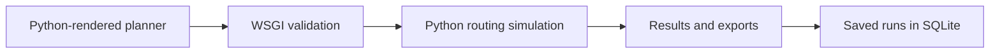

# ErrandLab

**Plan errands around uncertain travel, closing times and a deadline to get home.**

ErrandLab helps people who combine several stops into one outing. Enter two to six errands, opening hours, visit durations, approximate distances and a return deadline. The app compares four strategies, shows their timelines, and estimates how often each route completes every stop and gets home on time.

## Run locally

```bash
git clone https://github.com/adrian-hue-pixel/errand-lab.git
cd errand-lab
```

You can also download the repository ZIP and open a terminal in the extracted folder.

Requires Python 3.10 or newer. Routing runs locally using the Python standard library. Capi chat optionally contacts Groq with your own key.

```bash
python3 app.py
```

Open [ErrandLab on port 8501](http://127.0.0.1:8501). On Windows, use `py -3 app.py` if `python3` is unavailable. If the port is busy, run `python3 app.py --port 8502` and open port 8502.

1. Sign in with your email and password, create an account, or use **Demo quick sign-in** for an isolated temporary workspace. Existing username accounts can still sign in.
2. Open **Plan a route**, choose Closing time, and compare strategies. Save completed runs to your account.
3. Open **Settings** to select the theme, ambient motion, notification preferences and mascot visibility. To enable optional Capi chat, open **Settings**, paste your own Groq API key into **Groq API key**, and select **Save and test key**. Demo sign-in, route comparisons, exports and Cinema require no API key. It is held in browser session storage, scoped to the account and tab. On a shared computer, sign out when finished.
4. Open **Profile** to change your display name, avatar, role or bio. Signing out ends the server session. Demo workspaces are disposable.
5. **Sample route** supports a Three.js viewport and synchronized cinema player. West 112th Street features four supplied assets and a 12-second curbside arrival film. See [model integration](models/README.md) and [cinema integration](media/README.md).

The route grid uses approximate east/west and north/south offsets from home. For a shop 800 metres west and 300 metres north, use −0.8 and 0.3. Stops can have the same location. The app estimates travel time from the offsets and opening windows. Street directions and live traffic are outside this model.

## Research question

When errand closing times are tight, does delay-aware routing improve the chance of completing every stop and getting home on time compared with nearest-stop routing and an optimizer that assumes fixed travel times?

The primary outcome is **full success**, defined as completing every visit within its opening window and returning by the deadline. Secondary outcomes include mean completed stops, on-time return, median outing time, 90th-percentile outing time, and mean driving time.

## Benchmark results

These are **simulated outings**. Each comparison uses the same 600 held-out traffic draws per strategy. The four cases are hand-designed. Closing time was tuned during development to expose a fixed-time versus delay-aware trade-off. The independent held-out seed was used to estimate performance conditional on these cases.

| Scenario | Nearest stop | Fixed-time optimizer | Delay-aware | Difference vs nearest |
| --- | ---: | ---: | ---: | ---: |
| Closing time | 2.3% | 0.2% | 50.8% | +48.5 pp |
| Staggered openings | 0.0% | 52.5% | 52.5% | +52.5 pp |
| Spread-out stops | 89.5% | 89.5% | 89.5% | 0.0 pp |
| Relaxed Saturday | 100.0% | 100.0% | 100.0% | 0.0 pp |

- **Closing time.** The delay-aware route visits the parcel counter and library first. It finishes 3.36 of 4 stops on average, compared with 2.53 for the nearest-stop route. Its full-success lift over the fixed-time optimizer is **50.7 percentage points** with a paired simulation interval of **46.7 to 55.0 points**. Its median outing is longer than nearest-stop routing because it completes more errands.
- **Staggered openings.** Both optimizers choose the same route and reach 52.5% full success. Modeling the hours makes the visible difference here.
- **Spread-out stops.** Nearest-stop and both optimizers choose the same order. This is a useful case where the simple rule works.
- **Relaxed Saturday.** The delay-aware and nearest-stop plans tie. Reordering from the entered order saves **7.9 simulated median minutes**, from 88.8 to 80.9 minutes, with full success for both.

The [full evidence CSV](evidence/benchmark.csv) contains the unrounded rates and both paired comparisons. These modeled results give a hypothesis to test on real outings. They do not estimate real-world savings.

### How the comparison works

1. Convert the submitted locations into a distance-based travel-time matrix. The nominal time is straight-line distance × 1.2 for detours × 6 minutes per detoured kilometre.
2. Draw a shared daily traffic multiplier and a separate leg multiplier from mean-one lognormal distributions. The traffic setting controls their spread.
3. Enumerate every stop order, up to 720. The fixed-time optimizer maximizes priority-weighted completions minus a penalty of two points for a late return, breaking ties by elapsed time. The delay-aware optimizer uses the same utility across 48 training draws and adds 0.35 times the average utility of the lowest-scoring fifth. It breaks ties by full successes, then mean elapsed time.
4. Evaluate the selected orders with common random numbers on 600 held-out days. Resample paired success differences to estimate a 95% simulation interval. The intervals quantify Monte Carlo variability for the specified model and case. They do not account for model misspecification or selection of the example cases.

A route execution uses the current clock and the published hours. It can skip a stop known to be expired before departure. If it reaches a stop too late, the trip to that stop still counts. All strategies follow this same rule. The next experiment should preregister cases and collect anonymized road travel times, opening hours, durations and outcomes from several real outings.

For background on the established routing problem, see [Google OR-Tools’ routing with time windows guide](https://developers.google.com/optimization/routing/vrptw).

## Architecture



The Python routing engine is independent of the web layer. Three.js renders the separate 3D showcase, and optional chat runs in the browser. The risk-aware comparison emphasizes completing every errand inside its time window, alongside travel time and return reliability.

## Engineering and validation

```bash
python3 -m unittest discover -s tests -v
```

The local release check passed **22 automated tests**. The suite exercises routing edge cases, all 720 orders for six stops, seeded reproducibility, invalid inputs, the JSON and CSV endpoints, the sign-in gate, demo isolation, sign-up and sign-in, private saved routes, ownership isolation and CSRF handling. The web tests invoke the actual WSGI entry point with a temporary SQLite database.

- `routing.py` holds the model, route optimizers and evaluation.
- `ui.py` authors the server-rendered pages and graphics in Python. A small CSS file provides layout, contrast, focus indicators and responsive behavior. Python generates the layout rules, spring curves, map artwork and benchmark charts. A small local script updates stop summaries and shows route-comparison progress. The planner also works with JavaScript disabled.
- `app.py` handles requests, validation and exports.
- `store.py` keeps password hashes, sessions and reports in SQLite. Use `ERRANDLAB_DB` to set a custom database path. Put the WSGI app created by `app.create_app()` behind a production server and TLS if hosting publicly, and set `ERRANDLAB_HTTPS=1` for secure cookies. The bundled server is for local use.
- The JSON API is linked in the footer. Use `GET /api/v1/benchmark/closing` for the main case and `GET /run/<id>/json` with the owning browser session for a custom run.

### Iteration log

- The first route view compressed nearby stops. The final route grid fits its scale to the selected outing.
- Invalid coordinates could otherwise reach the math layer. The planner now rejects non-finite values and preserves circle-back edits in the form.
- Several shorter runs missed errands. The results now put full success and completed stops before outing time.
- Preset workflows, account flows and exports were tested through WSGI. Live browser and mobile checks, screenshots and real-user feedback are pending. The scenarios are the test evidence for this build.

## Triple H demo

1. **Problem.** “If the parcel counter closes soon, the nearest stop can be the wrong first stop.”
2. **Live demo.** Use Demo quick sign-in, open Closing time, run the comparison, then switch between Delay-aware and Fixed-time optimizer. Show where the parcel stop moves.
3. **Impact.** “In this model, 50.8% of runs finished every errand and got home on time with our route, versus 2.3% for nearest-stop routing. This is a simulation. In the relaxed case, nearest-first already works.”
4. **What’s next.** “Log real outings, validate the traffic estimates on a fixed test set and measure actual time saved and return visits avoided.”

### Submission checklist

| Rubric item | Evidence or next step |
| --- | --- |
| Functionality · 30% | Quickstart, input validation, test command and results |
| Value and impact · 25% | Four realistic scenarios and paired before/after results in the benchmark table and CSV |
| UX · 20% | See the iteration log. Add app screenshots, results from two browsers or devices, and any actual tester feedback |
| Creativity · 15% | Delay-aware routing compares the same outings under the same traffic draws. Capi also appears in the route studio |
| Presentation · 10% | Record a separate narrated pitch with problem, live demo, measured results and next steps |

The technical-track gate requires **at least 90% Python** in the final GitHub language bar. This build is approximately **81% Python by tracked authored Python, CSS and JavaScript bytes**, with vendored Three.js excluded. The current build is below the gate. Check the final GitHub bar before submitting.

Add the public GitHub URL, a runnable ZIP or deployed build, and the narrated video pitch to Devpost. The 12-second Cinema clip is an in-app showcase. The supplied rubric lists the deadline as **November 21, 2026 at 5:00 p.m. CST**.

Three.js r160 and its glTF loader are bundled locally under the MIT license in `vendor/three/LICENSE`. Locally hosted assets avoid sending account or API-key information to an external script provider. Groq receives requests only when the user tests a key or sends a chat message.
